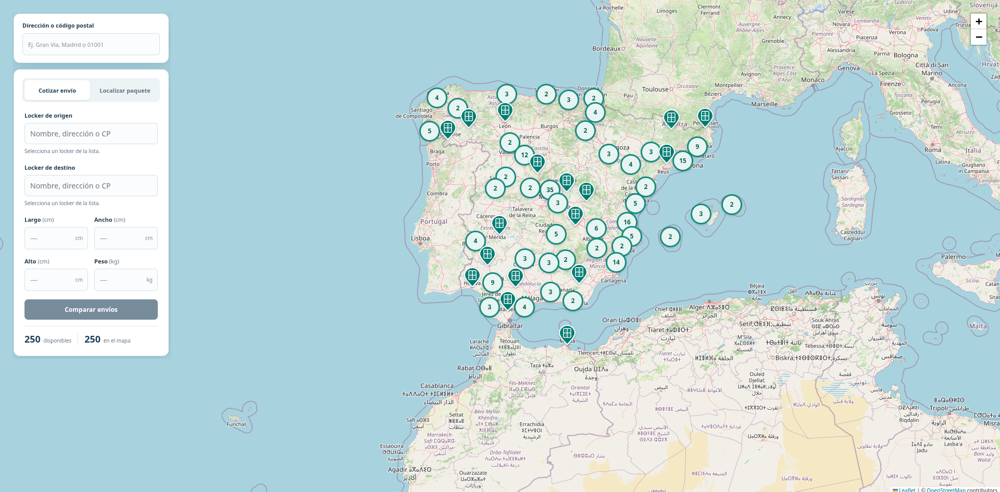
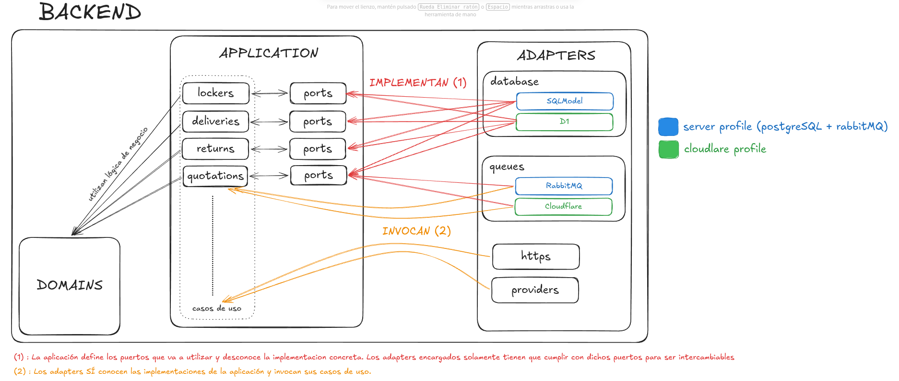

# Locker Management Demo

Recientemente sentí la necesidad de volver a experimentar como desarrollador y alejarme un poco de la gestión y coordinación de proyectos.
Quería poner en práctica de nuevo todos esos conceptos con mis propias manos en un proyecto desde cero, únicamente por curiosidad técnica y diversión: arquitectura hexagonal, testing, integración continua, iteraciones de mejora (plantear hipótesis → medir → mejorar) y workflows agénticos.

## Idea inicial

Al principio decidí crear un backend mínimo para la gestión de envíos y devoluciones de paquetería. Una vez definidos e implementados los dominios y los casos de uso, utilicé los puertos de persistencia para crear distintas implementaciones intercambiables del adaptador de persistencia. Así aproveché una de las principales ventajas de la arquitectura hexagonal para comparar su rendimiento.

En concreto, comparé estas tres implementaciones:

1. psycopg
2. SQLAlchemy ORM
3. SQLModel

La evaluación consistía en medir, para cada adaptador de persistencia, las latencias p50, p95 y p99 con distintas cargas y el mismo hardware. La carga se medía en flujos por segundo, donde un flujo representaba una operación compuesta (crear entrega → entregar → pedir devolución → completar devolución). Como ejemplo histórico de aquel experimento, para una carga de 30.000 solicitudes durante 15 segundos obtuve estos resultados:

| Adaptador | p50 | p95 | p99 |
|---|---:|---:|---:|
| psycopg | 298,9 ms | 513,7 ms | 564,6 ms |
| SQLAlchemy ORM | 683,5 ms | 1.046,8 ms | 1.782,7 ms |
| SQLModel | 617,2 ms | 1.221,7 ms | 2.089,8 ms |

## Cómo evolucionó el proyecto

Debo confesar que, a medida que avanzaba, más ganas tenía de convertirlo en un producto más completo y más real, y así fue.
Añadí funcionalidades como la gestión de taquillas y la comparación de ofertas de proveedores de envíos. Los proveedores son simulados: introducen retardos aleatorios y tienen probabilidades fijas de error o falta de respuesta; el comparador aplica un timeout a sus llamadas. Las tarifas de las respuestas exitosas son deterministas. Estos adaptadores podrían sustituirse por integraciones con proveedores externos.

Implementé una cola de tareas asíncronas y llevé la comparación de ofertas a un worker para procesarla fuera de la petición HTTP. La colección de proveedores es ampliable y sus llamadas tienen concurrencia limitada; el worker procesa las cotizaciones secuencialmente. Así preparé el proyecto para incorporar más proveedores que los tres actuales.

De hecho, hasta terminé desarrollando un frontend totalmente client-side para consumir el backend y poder mostrar un producto más o menos terminado.

A continuación, me gustaría entrar en más detalle en algunos de los puntos técnicos que considero más interesantes.

## Perfiles de despliegue

Como he explicado, el proyecto nació como una demo pensada para ejecutarse en local, con Docker Compose para el backend, PostgreSQL y RabbitMQ.
Como me gustó su evolución, quise explorar el despliegue con los recursos del plan gratuito de Cloudflare. Desarrollé un segundo perfil con Workers, D1 y Queues. El perfil `server` utiliza PostgreSQL mediante SQLModel y RabbitMQ; el perfil `cloudflare` utiliza los adaptadores de D1 y Queues sobre Workers. La ejecución nativa de Python Workers y Queues, así como la aceptación en el plan gratuito, siguen pendientes de verificación.

Una vez más, esto muestra uno de los grandes beneficios de la arquitectura hexagonal: utilizar diferentes tecnologías sin modificar el núcleo de negocio. Selecciono los adaptadores mediante el punto de entrada de cada perfil; ambos reutilizan el dominio y los casos de uso.

## Arquitectura hexagonal

La figura es un esquema conceptual de las capas y sus dependencias. Para interpretar la conexión con los proveedores, los casos de uso los llaman mediante puertos de salida; la flecha del esquema no representa la dirección de esas llamadas.

Estas capas permiten construir un backend con tecnologías intercambiables y con una clara separación de responsabilidades:

- **Dominio:** contiene las entidades y sus reglas de negocio esenciales.
- **Aplicación:** coordina los casos de uso apoyándose en el dominio y en interfaces (puertos), sin conocer las tecnologías concretas que hay detrás.
- **Infraestructura/adaptadores:** los adaptadores de entrada, como HTTP o el consumidor de la cola, invocan los casos de uso. Los de salida implementan los puertos de persistencia, mensajería y proveedores. Por ejemplo, los adaptadores SQLModel y D1 ofrecen implementaciones diferentes de los mismos puertos de persistencia.

La aplicación depende de esas interfaces y el punto de composición conecta los adaptadores concretos. Esta inversión de dependencias hace que las piezas sean intercambiables.

En el perfil `server`, puedo ejecutar la aplicación dentro o fuera de Docker Compose con PostgreSQL/SQLModel y RabbitMQ. En el perfil `cloudflare`, utilizo los adaptadores de Cloudflare. Ambos comparten el dominio y los casos de uso.

## Integración continua (CI/CD)

Como el proyecto creció más de lo previsto, incorporé CI para comprobar automáticamente las prácticas de desarrollo:

- Tests unitarios del backend, tests de integración con PostgreSQL y Alembic, y un smoke test con Docker.
- Análisis de tipos con Pyright, que debe terminar sin errores ni advertencias, y comprobaciones de linting y formato con Ruff.
- Un check local del perfil Cloudflare, que incluye sus contratos D1 y las comprobaciones del runtime.

Los checks del backend se ejecutan en las PR hacia `main` y en los pushes a `main`. No automatizan el despliegue. En las PR hacia `main`, otro check comprueba que no queden directorios de cambios activos en `openspec/changes/`. Explico este último punto a continuación.

## SDD

Durante el desarrollo de esta aplicación he utilizado workflows agénticos, en concreto SDD (desarrollo guiado por especificaciones) con OpenSpec y Codex.

OpenSpec organiza la creación y el seguimiento de especificaciones. Sus artefactos están en el directorio `openspec/`, que publico deliberadamente con el repositorio para que futuros agentes puedan revisar y entender las decisiones y funcionalidades desarrolladas.

En `.codex/agents/` se definen agentes con distintos modelos y responsabilidades para las fases de SDD. Con esta distribución busco mejorar el rendimiento y la eficiencia del trabajo. El directorio `.agents/skills/` enseña a los agentes cómo seguir el proceso, qué deben hacer en cada fase y qué herramientas tienen a su disposición.

Esta metodología documenta las especificaciones de principio a fin. Las especificaciones vigentes quedan en `openspec/specs/` y el historial de cambios archivados en `openspec/changes/archive/`. El check de cierre de CI comprueba que no queden directorios de cambios activos; no valida el contenido de sus tareas ni certifica que la implementación esté terminada.

## TO-DOS

Soy plenamente consciente de que hay muchas cuestiones de seguridad y funcionalidad y que el producto esta incompleto, algunos ejemplos son:

* Autenticación/permisos/roles
* Paginación en algunos endpoints de la API
* Idempotencia/Deduplicación en algunos procesos
* Funcionalidades en el frontend como terminar (simulado) el proceso de crear envio, funcionalidad "Localizar paquete" en el frontend, etc..

# https://locker-demo.mteixido.dev/
